<picture>
  <source media="(prefers-color-scheme: dark)" srcset="media/banner-dark.svg">
  
</picture>

A collection of generative line drawings. Each design is made by one algorithm (Perlin noise, a Hilbert curve, a Lorenz attractor, reaction–diffusion and so on). Pick a design, change its seed and style, and export it as an SVG to use on your own site.

The same design, seed and detail always give the same drawing and the same text. Each card's heading names the algorithm, and its description is written from values measured from that drawing.

## Run it

```bash
npm install
npm run dev
```

The site runs at http://localhost:5174. It's built with React, Tailwind CSS v4 and [shadcn/ui](https://ui.shadcn.com) on Base UI (style `base-nova`), on Vite. Add more shadcn components with `npx shadcn@latest add <name>`; they land in `src/components/ui/`. `npm run build` writes a static site to `dist/` that works on any static host. It assumes it's served from the root of a domain; to host it under a sub-path, set `base` in a Vite config.

`npm run banner` rebuilds the README banner (`media/banner-light.svg` and `media/banner-dark.svg`). It's set in `scripts/readme-banner.mjs`, where you can change the design, seed and detail.

## The site

- **Gallery** (`/`): every design as a live card, with filters for solids and line drawings, detail, animation, speed and shuffle.
- **Design page** (`/?d=flows&seed=6470&detail=5`): a large preview with seed, detail, animation, speed, line colour, background, transparency and line width. Every setting is kept in the URL, so links can be shared.
- **Export**: download an SVG, copy its code, or download an animated SVG that loops on its own with SMIL (no script). Animated files morph each shape smoothly when every frame has the same shapes, and otherwise swap whole frames.

Solid designs hide lines by filling each face with the background colour, so their faces stay filled even when the background is transparent.

## The card element

```html
<script type="module" src="/src/gen-card.js"></script>
<gen-card form="plates" seed="4821" detail="5" fig="0.3"></gen-card>
```

Add `animate` to loop the drawing by moving its own seeded values, and `speed` (for example `0.5`) to slow it down or speed it up. Each design sets its own loop length for normal speed. Cards stay still for viewers who have reduced motion turned on.

## Layout

- `src/designs/` holds one file per design. Each exports `{ id, kind, name, describe, draw }`, and optionally `loopSeconds`. To add a design, add a file and list it in `src/designs/index.js`.
- `src/core/geometry.js` has the shared geometry: isometric projection, the seeded random generator, boxes, prisms, noise and more. `src/core/marching.js` traces contour lines. `src/core/text.js` has small helpers for descriptions.
- `src/core/render.js` fits a drawing to the frame, turns faces into SVG paths, and builds the exported files.
- `src/gen-card.js` defines the `<gen-card>` element. It has no React or other dependencies, so it works on any page.
- `src/App.jsx`, `src/pages/Gallery.jsx` and `src/pages/Designer.jsx` are the site, with a small query-string router in `src/lib/router.jsx`. `src/components/GenCard.jsx` wraps the element for React, setting its attributes directly, because React would otherwise assign `animate` as a property and replace the element's built-in `animate()` method.

A design's `draw(out, R, detail, time, seed)` pushes faces into `out` and returns the facts its text needs. All randomness comes from `R`, called the same number of times at every `time`. `time` is in radians: 0 is the still drawing, and every motion repeats exactly every 2π. Solid faces must be pushed back to front, because each one is painted over the last to hide the lines behind it. Open lines (`open: true`) have no fill and can go in any order.
